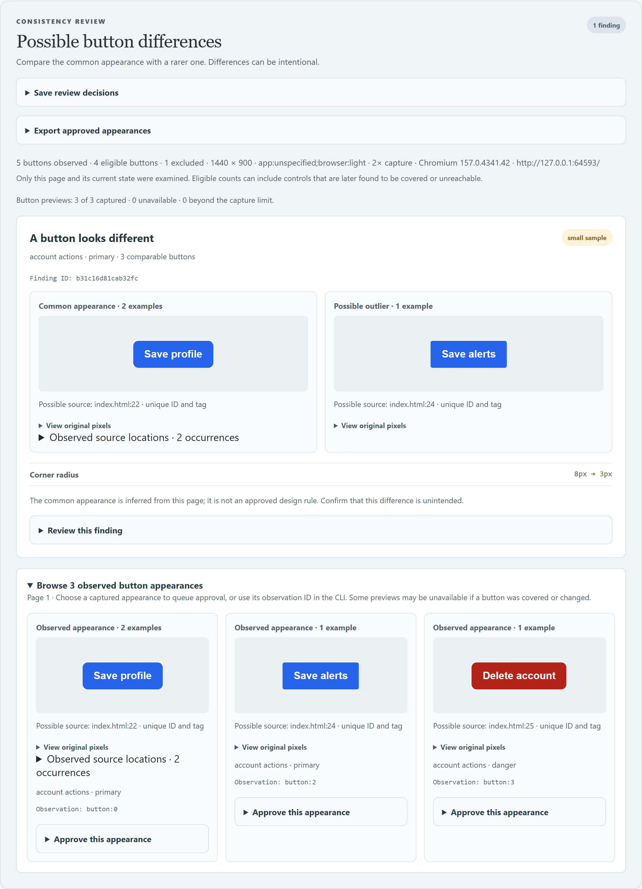
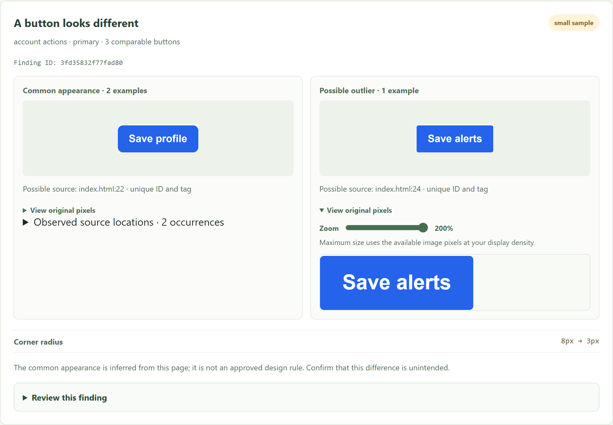
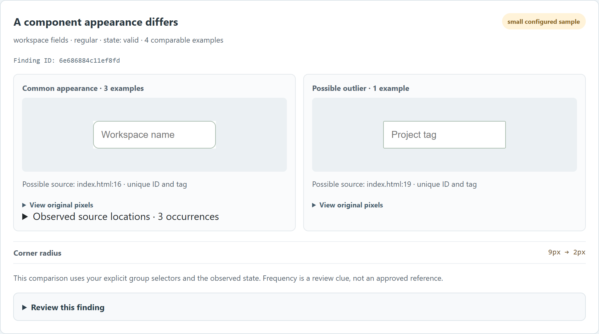
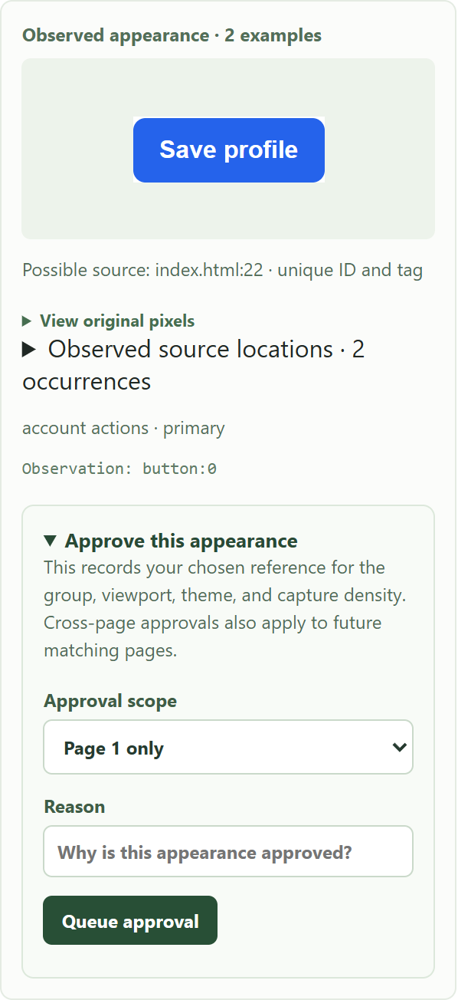

# Pieceboard


**See the real choices. Pick the right piece.** Pieceboard scans a project and builds an offline visual inventory of its components, styles, and assets. When you capture pages, it puts observed differences next to each other so a person can make a clear this-or-that decision.

The npm package and primary command are `pieceboard`. The older `ui-sheet` command, config filename, report directory, and JSON format IDs remain supported for compatibility. The package was previously called UI Sheet.

## Quick start

Requires Node.js 22 or newer:

```sh
npm install --save-dev pieceboard@alpha
npx pieceboard scan .
```

Open `.ui-sheet/index.html` in a browser. This first scan reads source files and needs no browser login or AI key. It can show where UI pieces are defined, but it cannot prove how a signed-in page rendered. To compare actual appearances, capture only pages you are authorized to inspect:

```sh
npx pieceboard scan . --page http://localhost:3000/ --capture
```

Start your own app first and replace the example URL with its actual page. The capture uses an isolated browser session; a page requiring sign-in needs an explicitly provided local storage state, as described below. Do not put credentials, session files, or private screenshots in a public report or package. Inspect the generated report and its capture warnings before treating any difference as a design decision.

For this-or-that review, compare the **same control or workflow destination** at the same role and viewport, record which observed version to follow, and rerun the capture after the change. A source item, synthetic illustration, or old screenshot is not proof that a current release behaves that way.

### Before you share a report

1. Open the generated `index.html` and read its warnings, scanned-source revision, capture status, route, viewport, and theme. If a page failed to capture, fix that failure and scan again; do not treat source-only results as a rendered comparison.
2. Compare actual captures of the same item. Check that the role, page, school or workspace, viewport, and served revision match the question you are deciding. Keep a source scan commit separate from a served website commit.
3. Use the report's decision or baseline action only for a verified finding. Record a reason. After changing code, scan the same context again and review any stale or unmatched decision rather than assuming it still applies.
4. Inspect `ui-sheet.json`, screenshots, paths, and source text before sending a report to anyone. The report is self-contained and can contain private information. Keep browser storage-state files and credentials outside the package and report.

### Maintainer: publish an alpha

The package is public once `npm publish` succeeds and cannot be treated as a private preview. Use the checked `alpha` tag so the release does not become `latest`:

```powershell
npm ci
npx playwright install chromium
npm test
npm run test:package
npm pack --dry-run
npm whoami
```

Review the dry-run file list. It must include the Pieceboard mark, CLI, source, tests' required runtime assets, README, and public examples; it must exclude local design-review folders, `.ui-sheet-lab/`, `.ui-sheet-auth/`, `node_modules/`, credentials, and project-specific screenshots. `npm run test:package` installs both the checkout and packed tarball in isolated temporary consumers and checks the command and report. If a command fails, fix it and rerun that command before publishing. Check `git status --short`, commit the reviewed release files, and push the source so the published tarball can be traced to a clean commit. Verify that the npm account shown by `npm whoami` is the intended owner.

For the first public prerelease, `npm view pieceboard version` may return `E404` because the name has not yet been claimed. That is a registry lookup, not a successful reservation. After all checks and file review, run:

```powershell
npm publish --tag alpha --access public
npm view pieceboard@alpha version
```

Complete the npm authentication or two-factor prompt locally; do not paste tokens or one-time codes into a chat, README, or shell history. The final command must print the exact version in `package.json`. If publishing fails, do not bump the version or retry blindly: read the registry error, check whether that version exists, then correct the cause. After success, install `pieceboard@alpha` in a fresh temporary project and run `npx pieceboard --help` and a source scan before announcing the release. Publish GitHub source only from a reviewed, clean history; local capture reports and private project screenshots must never enter that history.

The package includes the [project plan](https://github.com/FrankBoyle/pieceboard/blob/v0.1.0-alpha.4/PROJECT_PLAN.md) and [synthetic evaluations](https://github.com/FrankBoyle/pieceboard/blob/v0.1.0-alpha.4/evaluation/README.md) so readers can inspect the known successes and misses. Those studies are development evidence, not product-wide accuracy claims. See [data formats](https://github.com/FrankBoyle/pieceboard/blob/v0.1.0-alpha.4/docs/data-format.md) for the current agent and CI outputs.

Integrations can validate the shipped [JSON contracts](https://github.com/FrankBoyle/pieceboard/blob/v0.1.0-alpha.4/docs/schema.md) locally. Source matches and visual findings require human review; they are not product-wide accuracy claims.

> **Early alpha.** The scanner supports JavaScript/TypeScript with JSX, static HTML/PHP markup, plain CSS, and local image/font files. Browser captures provide actual element previews and possible style differences. Approved references are available for native buttons and explicitly configured UI groups. Source links remain limited evidence; see the installation instructions below.



The example uses synthetic content. The buttons are real browser captures; the different radius is a possible finding for a person to review.

## Try the example

Requires Node.js 22 or newer.

```sh
npm install
npx playwright install chromium
npm run demo
```

Open `.ui-sheet-demo-elements/index.html`. The default demo serves a synthetic workspace briefly, captures real fields, tabs, dropdowns, selectors and buttons, writes its offline report, and closes its server. Set `UI_SHEET_BROWSER` to an installed compatible browser path if you prefer that to the Chromium download. The generated HTML works offline; `ui-sheet.json` contains the same machine-readable evidence.

For a source-only example requiring no browser, run `npm run demo:inventory` and open `.ui-sheet-demo/index.html`. [`examples/harbor`](https://github.com/FrankBoyle/pieceboard/tree/v0.1.0-alpha.4/examples/harbor) uses supplied SVG illustrations to demonstrate manual preview metadata; those illustrations are not browser captures.

### Try a button consistency finding

The synthetic [`examples/button-review`](https://github.com/FrankBoyle/pieceboard/tree/v0.1.0-alpha.4/examples/button-review) contains two similar primary buttons, a third with an intentionally different corner radius, and an intentional destructive button. Install Playwright's browser once, then run the example:

```sh
npx playwright install chromium
npm run demo:consistency
```

Open `.ui-sheet-demo-consistency/index.html`. The script starts a temporary server for the example, captures real buttons, writes an offline report, and closes the server. Alternatively, set `UI_SHEET_BROWSER` to the path of a compatible installed browser before running the example.

Run `npm run demo:cross-page` for a second synthetic example with one button on each of three pages. Open `.ui-sheet-demo-cross-page/index.html` to see the cross-page comparison, or [view the example image](https://raw.githubusercontent.com/FrankBoyle/pieceboard/v0.1.0-alpha.4/docs/images/cross-page.png).

Run `npm run demo:elements` for a synthetic workspace with fields, dropdowns, tabs, selectors, and actions. Open `.ui-sheet-demo-elements/index.html` to review four configured-family differences and one native-button difference. These are genuine 2× captures; set `UI_SHEET_PIXEL_RATIO=4` for a denser capture. The single intentional destructive action remains an undersampled group until a reviewer approves a reference.

To refresh the README image from this synthetic example, run `npm run screenshot:demo` after `npm run demo:consistency`. The screenshot command uses the same optional `UI_SHEET_BROWSER` setting.

To refresh the zoom example, set `UI_SHEET_PIXEL_RATIO` to `4`, run `npm run demo:consistency`, and then run `npm run screenshot:demo -- --zoom`.

To refresh the visual-approval example, run `npm run demo:consistency` and then `npm run screenshot:demo -- --approval`.

### How this fits with existing tools

[Storybook](https://storybook.js.org/docs/writing-docs) is useful for documenting components and their deliberately authored stories. [Playwright visual comparisons](https://playwright.dev/docs/test-snapshots) compare a page or element against a reference screenshot. Pieceboard explores selected rendered pages, groups observed button styles, and points to possible source locations; its suggestions and source matches need review. These approaches can be used together.

## Use it in a project

From the root of your own project, install the early alpha from npm:

```sh
npm install --save-dev pieceboard@alpha
npx pieceboard scan .
```

To install from a local checkout on Windows, quote the checkout path if it contains spaces:

```powershell
npm install --save-dev "C:\path\to\pieceboard"
npx pieceboard scan .
```

Open `.ui-sheet/index.html`. Run the scan again after changing your UI. Add `.ui-sheet/` to your project's `.gitignore` if you do not want to commit generated reports.

To save your usual source scope and pages, run `pieceboard init` and edit the resulting `ui-sheet.config.json`:

```json
{
  "name": "My app",
  "include": ["src", "styles"],
  "pages": ["http://localhost:3000/", "http://localhost:3000/settings"]
}
```

`pieceboard scan .` remains a source-only scan. After installation, source-only scanning needs no network connection, AI API key, or model training. `pieceboard scan . --capture` uses the configured pages and renders their JavaScript; fetching or capturing a page requires access to that page. Explicit `--include` or `--page` arguments replace the respective configured list for that run. `init` never overwrites an existing configuration. Optional `"decisions"` and `"baseline"` paths can point to files inside the project for captured scans; explicit `--decisions` and `--baseline` arguments take precedence.

Each page capture has a two-minute deadline, including renderer work, followed by up to fifteen seconds for browser cleanup. Set `"captureTimeoutMs": 300000` for a deliberately longer capture (1,000–900,000 ms). A timed-out or failed capture does not publish its partial evidence. A browser that itself refuses to close can still require task-process inspection; the error reports that separately.

Captured scans default to a 1440 × 900 viewport, a light browser color preference, and a 2× device pixel ratio. Use `--viewport 390x844 --color-scheme dark` for a mobile-size viewport and dark browser preference, or set `"viewport": { "width": 390, "height": 844 }` and `"colorScheme": "dark"` in the configuration. CLI options override those settings. The ordinary appearance comparison uses one viewport, pixel ratio, and color preference for all selected pages; the optional responsive audit below tests additional widths in the same run. A browser color preference only affects sites that respond to it; Pieceboard does not click an application's theme switch. The report records the detected app theme and browser preference, and decisions and baselines are scoped to viewport, detected theme, and pixel ratio.

### Inspect responsive layouts

Start your app and capture a selected page at multiple widths in one run:

```sh
npx pieceboard scan . --page http://localhost:3000/ --capture --responsive
```

The responsive review opens the page in a fresh Chromium context at 320 × 800, 390 × 844, 768 × 1024, 1024 × 768, and 1440 × 900 CSS pixels. It runs the page's JavaScript at each size and inspects rendered geometry for possible horizontal overflow, clipped text, and overlapping text. The offline report groups findings by exact width and shows the inspected selector, measurements, real browser captures when available, and a concrete CSS example when the evidence supports one. Suggestions are starting points for review; Pieceboard does not apply them and does not need an AI agent or API key.

To test specific sizes, repeat `--responsive-viewport`; these replace the defaults for that run:

```sh
npx pieceboard scan . --page http://localhost:3000/ --capture --responsive --responsive-viewport 375x812 --responsive-viewport 820x1180 --responsive-viewport 1440x900
```

Alternatively, set `"responsiveViewports": [{ "width": 375, "height": 812 }, { "width": 1440, "height": 900 }]` in `ui-sheet.config.json` and use `--responsive`. You can select one to eight unique sizes. `--color-scheme`, `--pixel-ratio`, explicit page actions, browser state, the per-page capture deadline, and screenshot masks also apply to the responsive audit. Each size reloads the page; finding screenshots may scroll the page and therefore trigger ordinary scroll-driven behavior. Scans with several widths can take longer; increase `captureTimeoutMs` when needed.

The checks are bounded heuristics, not proof that a page is responsive at every width. They can miss issues or flag intentional truncation, overlap, or scrolling. Visible frames and open shadow roots are not inspected and make coverage partial; closed shadow roots, canvas content, hidden states, interactions, and unselected routes are not covered. Unstable measurements and inspection limits also mark coverage partial, and failed viewport loads are incomplete. The report limits screenshots to eight per viewport and 24 MiB of encoded responsive images per report, and labels missing evidence. It records conventional `#/...` and `#!/...` route paths without their query parameters; route paths and screenshots can contain private content. Use `--mask-selector` where appropriate and review the report before sharing. The existing `check` and `check-layout` commands do not evaluate responsive findings.

Reports record the Chromium version and, when the enclosing Git checkout tracks at least one scanned source file, its commit and working-tree status. They also show how many scanned source files are tracked in that checkout; ignored or untracked files can make the count incomplete. Changed file names are not stored by this check. This Git context does not prove that all scanned files were committed or that the rendered site is running that revision. Browser versions are recorded for context but do not currently scope baselines.

Use **Browse by UI type** to filter the current view to tabs, sidebars, headers, buttons, dropdowns, selectors, inputs, navigation, headings, text, and images. The categories are inferred from element tags, accessibility roles, component names, classes, and capture locations, so review them as suggestions. One piece can appear in more than one category. A category with zero results means no matching pieces were found in the current view, not necessarily that the project has none.

The report supports keyboard navigation: use the skip link to reach the main content, Tab and Enter or Space to choose filters, `/` to focus search when not editing, and Escape to close a details dialog. Filter focus is retained after a selection, and the report respects the browser's reduced-motion preference. Automated [axe checks through Playwright](https://playwright.dev/docs/accessibility-testing) exercise selected WCAG A and AA rules on the synthetic report at desktop and mobile sizes, including expanded review controls and the details dialog. Automated checks cover only some accessibility issues and are not a complete accessibility audit.

The report footer shows when source scanning occurred, in UTC, so an older report is easier to recognize. A timestamp alone does not establish that a report is current.

When a report has no captured images, it starts in **UI-focused**, which shows recognizable UI types plus design tokens and assets. This is a browsing filter: named application components that do not have a recognizable type remain in **All pieces**. It does not reduce which source files are scanned.

To scan another directory or choose an output directory, run:

```sh
pieceboard scan path/to/project --out path/to/output
```

The `--out` path is resolved from the current working directory. Pieceboard will replace its own generated `index.html` and `ui-sheet.json`, but refuses to overwrite unrelated files with those names.

### Scan only the UI code you need

For larger repositories, repeat `--include` with project-relative files or directories. This avoids scanning unrelated application data and generated files:

```sh
pieceboard scan path/to/project --include src --include packages/ui/src --out path/to/output
```

Include the relevant CSS and image directories if you want selector links and asset previews. The report identifies itself as scoped when include paths were supplied. Paths outside the project and symlinks are rejected or skipped.

To inventory selected files from multiple local projects, scan their common parent and include only the UI paths you want:

```sh
pieceboard scan /path/to/projects --include project-one/src --include project-two/src --out .ui-sheet
```

Source locations are relative to the common parent. Git context describes only the enclosing checkout, if one exists; it does not record a separate commit for each nested repository. If selected workspace packages share a name, Pieceboard warns and leaves imports from that name unresolved instead of guessing which package they reference. A combined source scan alone does not capture rendered pages.

To omit files or directories inside an included scope, repeat `--exclude` or add an `"exclude"` array to `ui-sheet.config.json`:

```sh
pieceboard scan . --include src --exclude src/private --exclude src/generated.jsx
```

CLI exclusions are added to configured exclusions and take precedence over includes. Use existing project-relative paths rather than glob patterns; missing paths and symlinks are rejected so a typo does not silently expand the scan. This prevents the scanner from reading those source files, but it does not redact references to them that appear in other included files, hide data rendered by a page, or prevent the tool from reading its own configuration. Check the resulting report before sharing.

### Compare source with a page

For a page you are authorized to inspect, add its URL:

```sh
pieceboard scan path/to/project --include landing.php --include landing_styles.css --page https://example.com --out path/to/output
```

The tool fetches **one HTML response per supplied page**, without cookies or executing page scripts. It flags an element as a **possible match** only when its static ID is unique in both the scanned source and the fetched HTML, and the tag names agree. The report stores the page URL without its query string, the matching ID, and the source location; it does not save the fetched HTML. It does not authenticate, click through an app, render CSS, or see elements generated by JavaScript. Cross-origin redirects are rejected, and responses are limited to 2 MB.

A match is a clue, not proof that the local source revision is deployed. A page without stable IDs may have few or no matches. Repeat `--page` to inspect more than one explicitly selected page; each page must be reachable without authentication and is checked separately.

### Capture real component images

Add `--capture` to open the page in an isolated, headless browser and capture screenshots of matched visible elements:

```sh
# Install a browser once, after installing Pieceboard.
npx playwright install chromium

pieceboard scan path/to/project --include src --include styles --page https://example.com --capture --out path/to/output
```

You can use a compatible installed Chromium-based browser instead of downloading one:

```powershell
pieceboard scan path/to/project --include src --page https://example.com --capture --browser "C:\path\to\msedge.exe"
```

The sheet embeds actual PNG captures and opens on the **Captured on page** view when images were found. Each screenshot appears as its own tile; open one to see its source locations and related examples. In the details, choose **View full-size capture** to inspect the original pixels in a scrollable area, with a zoom control where the image has enough pixels for your display. Choose **All pieces** to include items without captured images. Automatic captures default to 2× density; an image that exceeds the 1 MB limit is retried at 1×. The viewer does not stretch small captures to fill a tile. Separately supplied images retain their original resolution.

For small controls on a high-density screen, request more image detail with `pieceboard scan . --capture --pixel-ratio 4`, or set `"pixelRatio": 4` in the configuration. Values 1 through 4 are supported, and the CLI overrides the configuration. The CSS viewport dimensions stay the same, but changing device pixel ratio can affect a site's styles or JavaScript; compare and approve patterns using the same ratio. The viewport and ratio together are limited to 33,177,600 device pixels to keep captures manageable. A larger capture can still fall back to 1× when it exceeds the image-size limit, and a zoom control cannot create detail missing from the original image.



Automatic capture focuses on UI controls, navigation, headers, headings, and likely brand assets. It skips ordinary paragraphs, generic links, content images, and oversized controls instead of treating every visible piece of page content as a reusable UI element. Repeated simple links, headings, or labels with the same detected style contribute one preview per inventory item; their source references are still retained. These heuristics may miss a custom control or a meaningful visual difference; add a screenshot manually when needed. This filter limits previews, not all source analysis: the scanner can still find many named application components, tokens, and assets. Use `--include` to narrow the source files as well.

### Include a custom UI class in the inventory

If your project has a control that the default inventory misses, you can explicitly assign its CSS class to a UI type in `ui-sheet.config.json`:

```json
{
  "inventoryClasses": [
    { "className": "donationbutton", "type": "buttons" },
    { "className": "custom-picker", "type": "dropdowns" },
    { "className": "custom-picker", "type": "selectors" }
  ]
}
```

Use exact, case-sensitive class names without a leading dot, not CSS selectors. Supported types are `tabs`, `sidebars`, `headers`, `buttons`, `dropdowns`, `selectors`, `inputs`, `navigation`, `headings`, `text`, and `images`; up to 50 class/type pairs are allowed. The scanner recognizes static classes in selected HTML/PHP and native JSX/TSX markup. Dynamically generated classes and components whose markup is not scanned can still be missed. Captured examples need an unambiguous source-to-page match; a unique configured class and tag can provide a possible match, not proof of deployment. Reports label the classification as configured.

This setting controls inventory and sorting. It is a project-supplied description, not proof of accessibility, interactivity, or design intent. A custom `div` classified as a button is **not** added to the native-button consistency check; its report can still show insufficient comparison coverage.

### Compare tabs, fields, and other UI groups

Use explicit `elementGroups` to compare selected inputs, dropdowns, selectors, tabs, headers, sidebars, navigation, headings, or text styles:

```json
{
  "elementGroups": [
    { "selector": ".form-field", "family": "form fields", "type": "inputs" },
    { "selector": "[role=tab]", "family": "workspace tabs", "type": "tabs" }
  ]
}
```

Then run the usual captured scan. The report shows real component previews, differences, source evidence, counts, and review controls; `check --json` includes their findings and `elementPages` coverage. Native type, semantic role, selection, checked, disabled, validation, focus, and hover states are kept separate. Composed headers and sidebars compare their own supported computed styles, rather than every descendant. Simple `.class` group selectors also classify selected static markup in the source inventory; complex selectors may need existing UI roles or `inventoryClasses` to establish source clues. See [configured UI groups](https://github.com/FrankBoyle/pieceboard/blob/v0.1.0-alpha.4/docs/element-groups.md) for limits. This extension is experimental and has no representative accuracy claim.



Use `element-appearances REPORT --page 1` for compact measured styles and `element-locations REPORT --family "workspace fields"` for every recorded family occurrence. In the report's configured appearance gallery, **Approve this appearance** queues a chosen page or explicit cross-page reference; **Export approved UI group appearances** imports and downloads its separate baseline file. Apply it on the next scan using `--element-baseline FILE` or the `elementBaseline` configuration path. Importing or downloading a file does not apply changes automatically.

For every recorded location sharing a particular finding's appearance, run `pieceboard finding-locations REPORT --finding ID`; add `--side common` for its reference appearance. Repeated appearances also offer **Observed source locations** in the visual report. These lists cover selected, observed controls and preserve unresolved source entries; they do not claim an exhaustive dependency graph.

Captures make no configured interactions by default. To inspect a particular focus or hover state, opt in for an exact page URL:

```json
{
  "pageActions": [
    { "page": "http://localhost:3000/settings", "actions": [{ "kind": "focus", "selector": "#display-name" }] }
  ]
}
```

Each action must select exactly one element, and the requested state must be established before measurement. Only `focus` and `hover` are supported; they can trigger the page's event handlers. Use authorized demo/development pages and record separate reports for other states. Selected actions and comparison groups are part of the report-comparison context. Ordinary input values are not used as state metadata; source text, labels, screenshots, and other report fields still need review before sharing.

### Review possible button differences

The `--capture` workflow also measures enabled, visible native `<button>` elements on the selected page **before** screenshot deduplication. It compares computed colors, supported gradients, opacity, supported CSS filters, each border side's width, style, and color, corner radii, typography, text transform and decoration, padding, and shadows. It excludes disabled, focused, hovered, toggle, disclosure, active-class, and non-button-role controls from this first comparison. Width and height are not compared because different labels can legitimately change a button's size. Image-based backgrounds, ancestor filter/opacity effects, transforms, clipping, and other unmeasured properties remain outside this comparison.

Buttons with image-based or unsupported background layers are excluded from the button comparison and counted as missing style evidence; their background URLs are not retained in measured button styles. The page can still load its own assets, screenshots can contain their pixels, and other source-derived report fields can contain sensitive information. Review reports before sharing.

For up to 500 visible buttons fully inside the initial viewport, the scanner checks nine points with the browser's hit testing. When all points resolve and one reaches an unrelated element, it excludes the button as **possibly blocked** and marks coverage incomplete. An offscreen or partially offscreen button remains eligible, but its visibility is marked unverified and coverage is partial; buttons beyond the check limit are also unverified. Hit testing is only a clue: for example, an overlay with `pointer-events: none` may still obscure a button visually, and a button with unusual pointer-event behavior may be excluded even when visible. The page can also change after observation. Review the actual previews and run separate scans for the states and pages that matter.

The report suggests a possible difference when a group contains a repeated appearance and one rare appearance; tied appearances are not assigned a common style. A two-against-one comparison is explicitly labeled a small sample. The most frequent appearance is a clue, not an approved standard. Repeat `--page` to capture multiple routes in the same report. By default each route is analyzed separately; the opt-in cross-page check is described below. Only the supplied pages, viewport, and current state are checked, so hidden or dynamic elements and other routes can be missing. The tool can miss meaningful differences or group unrelated buttons together.

Classes such as `primary`, `secondary`, and `danger` are used as tentative variant hints. A shared component class or immediate container provides a tentative family when no explicit group is supplied. Projects can provide clearer hints with `data-ui-sheet-group="account actions"` and `data-ui-sheet-variant="primary"` on comparable buttons. These attributes are optional, and their values are not verified design rules. A comparison preview is omitted if its element changes or is covered before capture. Source evidence is labeled likely, manually linked, instrumented, or unresolved rather than presented as proof of the deployed revision. The structured observations and findings are available under `consistency` in `ui-sheet.json`.

To group comparable buttons that use different classes without editing the application, add rules to `ui-sheet.config.json`:

```json
{
  "buttonGroups": [
    {
      "selector": ".add-project-btn, .add-task-btn, .add-note-btn",
      "family": "add actions",
      "variant": "icon"
    }
  ]
}
```

Selectors are matched against rendered native buttons on each selected page. A configured family and, if present, variant take precedence over page attributes and class inference. Omit `variant` to keep the detected variant. Rules must not overlap on a button; invalid or overlapping selectors stop the scan. A configured group is a comparison hint, not an approved design baseline. Review whether its controls truly have the same purpose, state, and intended design.

### Compare across pages

For explicitly named button groups and variants, add `--cross-page` to a captured scan with multiple selected routes:

```sh
pieceboard scan . --capture --cross-page --page http://localhost:3000/ --page http://localhost:3000/settings --page http://localhost:3000/profile
```

The cross-page check counts each appearance once per page, so repeated controls on one page do not by themselves establish the reference. It suggests a difference when the common appearance occurs on at least two pages and a different appearance occurs on one page. At least three pages with the same explicitly defined group and variant are needed for that pattern; ties and smaller samples are incomplete evidence. Only the same viewport, detected theme, pixel ratio, and browser context are compared. Query strings are excluded from report identities, so duplicate routes cannot be distinguished by query alone.

The result includes actual representative captures when available, source clues, and review controls for uniquely source-anchored findings. It is also included in `pieceboard check` and its coverage. By default, its reference is inferred from page frequency; page-specific baselines are not automatically applied across routes. Review every suggestion for intentional differences.

You can explicitly approve an observed appearance for the same named group and variant across selected pages:

```sh
pieceboard appearances .ui-sheet --page 1
pieceboard baseline .ui-sheet --file ui-sheet.baselines.json --observation button:0 --page 1 --cross-page --reason "Approved save action across pages"
pieceboard scan . --capture --cross-page --baseline ui-sheet.baselines.json
```

Use an observation ID from your report. Cross-page approval requires an explicitly named group and variant, and applies to that group at the same viewport, detected theme, and pixel ratio on every selected page, including pages not present when it was approved. It takes precedence over frequency, even when no selected page still displays the approved style; in that case the reference image is unavailable but the measured values are compared. Browser version is recorded but does not yet scope a baseline. A cross-page approval does not automatically create per-page approvals.

### Record a review decision

In the visual report, open **Review this finding**, choose a decision, provide a reason, and select **Queue decision**. Open **Save review decisions** above the findings and download the resulting JSON file. If you already have a decision file, import it there first to preserve its other entries, including decisions that no longer match this report. Queued changes remain in the open report only until you download them; they are not automatically written to disk or applied to a future scan. Findings without a unique source anchor cannot yet receive a persistent decision.

You can also record a reasoned decision from the command line:

```sh
pieceboard decision .ui-sheet --file ui-sheet.decisions.json --finding 0123456789abcdef --status intentional --reason "This action is intentionally distinct"
```

Replace the sample ID with the ID from your report. Statuses are `intentional`, `needs-fix`, `deferred`, and `false-positive`. The command updates the existing report and creates or updates only a recognized Pieceboard decision file; it refuses to overwrite unrelated data. A finding without a source anchor cannot yet receive a persistent decision.

To apply the same file to a later capture, add `--decisions ui-sheet.decisions.json` to the scan command. Findings remain visible with their review status and reason. A decision is tied to the page, group, compared appearances, and source identity. When an automatically matched static element ID is unique in the selected supported source markup and on the rendered page, a line move within the same file can retain the decision. For this purpose, IDs must start with a letter, contain only letters, digits, `.`, `_`, `:` or `-`, and be at most 100 characters. Scan warnings disable this ID-based stability because source coverage may be incomplete. Manual and other inferred links remain tied to their source line; instrumented links also include the source column and file fingerprint. Changes to the group, appearance, page, file, or ID can make a decision stale. A reused ID could still refer to a different element, so review saved decisions after repurposing controls. Source matching remains a clue rather than proof. Review a decision file before committing it, since its reasons and source details may be project-specific.

The finding-identity version changed when opacity/filter measurements and repeated-deviation handling were added. Regenerate both reports before comparing them; saved decisions whose finding IDs changed are counted as stale and should be reviewed again. Button baseline versions 1–3 and element baseline version 1 lack current measurements: preserve the old file, temporarily remove its `baseline` or `elementBaseline` configuration, capture a fresh report, and reapprove appearances in a new file. Current button baselines are v4 and element baselines v2. Pieceboard will not guess missing values or overwrite an unsupported old file.

### Approve an appearance

In the visual report, open **Browse observed button appearances**, choose **Approve this appearance** under a captured example, select the scope, enter a reason, and queue it. Open **Export approved appearances** and download the baseline file. Import your existing baseline file there first to preserve its other approvals; a later queued choice for the same group and scope replaces the earlier one. The original imported file is not modified. Supply the downloaded file with `--baseline` on the next scan, or save it inside the project and configure `"baseline"` to point to it. Imported rules are validated by the next scan.



Visual approval requires a captured preview, a known theme, a stable group, and distinct page scopes. It is unavailable when screenshot masks are configured, because a masked preview may hide the appearance being approved. Cross-page approval also requires an explicitly named group and variant; it applies to future matching pages as well as the selected pages. Regenerate older reports to obtain the visual approval controls. You can still use the CLI when a preview is unavailable, after checking the appearance by other means.

From the command line, you can choose the common appearance or the outlier from a finding as the approved reference for that component group:

```sh
pieceboard baseline .ui-sheet --file ui-sheet.baselines.json --finding 0123456789abcdef --example common --reason "Approved primary action"
pieceboard scan . --capture --baseline ui-sheet.baselines.json
```

Replace the sample ID with a finding ID from the report. `--example outlier` approves the rarer appearance instead. To approve an observed appearance even when there is no finding, list styles and use an `example` ID from the result:

```sh
pieceboard appearances .ui-sheet --page 1
pieceboard baseline .ui-sheet --file ui-sheet.baselines.json --observation button:0 --page 1 --reason "Approved primary action"
```

The appearance command contains measured values and counts without images. Open **Browse observed button appearances** in the visual report to see captured examples and their observation IDs, even if no difference was found. Captures are limited and can be unavailable when an element is covered or changes. Select the actual observation ID returned by your report. `--page` is required for a multi-page report. The baseline is limited to the selected page, viewport, detected theme, pixel ratio, and stable explicit group, configured group, or component class; it does not automatically apply across routes. Theme detection uses common attributes and browser color-scheme preferences and may not identify a custom theme. An approved appearance takes precedence over the most common one, even if it becomes a minority. The file contains measured style values and source evidence, not screenshots. If no approved example is visible during a later scan, its preview is unavailable but its values are still compared. Baselines that do not match the current scan are counted separately. Query strings are omitted from report identities, so baselines cannot be used for multiple pages with the same route, viewport, and theme.

For an explicitly named group, the gallery also lists other selected pages where that group was observed. To get individual source clues across all captured pages as compact JSON, use the family and variant names from the report:

```sh
pieceboard locations .ui-sheet --family "save actions" --variant primary
```

This lists observed occurrences, not every possible usage: unvisited routes, hidden states, source matches that could not be resolved, and results beyond the limit can be missing. Other pages in the same group can contain different appearances.

### Summarize a report for an agent or CI

```sh
pieceboard check .ui-sheet --json
pieceboard check .ui-sheet --fail-on-findings --strict-coverage
```

The JSON summary contains findings, source evidence, review status, source-warning count, per-page coverage, and counts of requested, captured, unavailable, and limit-omitted button previews, but does not include screenshot data. `check` reports by default. With `--fail-on-findings`, it exits with code 1 for an unreviewed or `needs-fix` finding; `intentional`, `deferred`, and `false-positive` decisions remain visible but are not treated as actionable. With `--strict-coverage`, insufficient or partial evidence exits with code 2. Older comparison measurements, source scan warnings, missing warning or visibility metadata, possibly blocked or visibility-unverified buttons, unsupported button backgrounds, and missing or limit-omitted representative previews make coverage incomplete. When there are no actionable findings and coverage is partial or insufficient, the JSON result is `insufficient-evidence`. Regenerate older reports that lack this information. Invalid or unreadable reports also exit with code 2. An `observed` coverage result only describes the eligible groups on the selected pages; it does not prove that the rest of the app is consistent or that every occurrence was unobscured.

CLI scans record their completion in `.ui-sheet-scan.json` in the report directory. If a scan fails after it starts, `check` exits 2 rather than treating any remaining report as fresh. A failure during report writing can leave incomplete output. A missing completion record makes coverage partial. Copy the status file together with `ui-sheet.json` when saving a report for later comparison. If a scan is interrupted and leaves `.ui-sheet-scan.lock`, first verify that no scan is still running; then remove that lock file and run the scan again. The status file contains a run ID and status, not page data. Completion does not prove the source or deployed site has stayed unchanged since the scan.

Always stop your workflow when the scan command fails. Errors during argument parsing or before the output directory can be opened cannot update the status record, so a separate later check alone cannot establish that the intended command ran. In CI, run the scan and check as separate steps that stop on failure.

To compare with a previously generated report, keep it in a separate directory and run:

```sh
pieceboard check .ui-sheet --previous .ui-sheet-previous --json
pieceboard check .ui-sheet --previous .ui-sheet-previous --fail-on-new
```

The comparison counts current actionable, source-anchored finding IDs absent from the previous report. It requires the same selected routes, viewport, detected theme, pixel ratio, Chromium version, finding identity version, and source-instrumentation setting. Reports made before pixel ratio was configurable are treated as 2×; regenerate older reports that lack other context or use an older identity version. With `--fail-on-new`, new findings exit 1; incomplete coverage or unanchored findings exit 2, rather than claiming a clean comparison. A moved source line can retain an ID only in the unique-static-ID case described above; other source moves or appearance changes can produce a new ID for a related issue. This is a comparison of reports, not a complete analysis of a pull request or proof that unobserved UI is consistent. Use `--fail-on-findings` as well if existing unresolved findings should fail the check.

For a compact inventory without embedded images, use:

```sh
pieceboard catalog .ui-sheet --kind components --search button
```

The catalog returns JSON with definitions, source references, and preview availability. Use `--id` for one item, or `--limit` to control the number of entries. Source references are static scan results and may be incomplete.

### Detect spacing and logo anomalies

Use opt-in `layoutChecks` to measure actual text clearance inside a container, gaps between wordmark parts, computed margins/padding/word spacing, and use of approved logo image paths without stretching. Findings appear in a separate report section with measurements and genuine previews. Run `npm run demo:layout` for seeded examples, or `pieceboard check-layout .ui-sheet --json` after a configured capture.

Rules remain explicit, and missing or unsupported targets stay incomplete. Screen and print-preview contexts are separate; direct PDF auditing is planned. See [layout checks](https://github.com/FrankBoyle/pieceboard/blob/v0.1.0-alpha.4/docs/layout-checks.md) for configuration and limits.

### Keep approved design-token values consistent

Source-only scans record CSS custom-property declarations separately by file, selector, and enclosing at-rule. Use `pieceboard tokens .ui-sheet --name --control-radius` to inspect them, `pieceboard token-baseline` to approve a specific declaration, and `pieceboard check-tokens` to check a fresh scan against those approvals. The visual inventory also shows the separate scoped values.

Light/dark overrides remain separate. Changed, missing, ambiguous, and unscanned declarations have distinct results; this check does not resolve the CSS cascade or runtime values. See the [complete token approval and CI workflow](https://github.com/FrankBoyle/pieceboard/blob/v0.1.0-alpha.4/docs/token-contracts.md).

### Give a coding agent the workflow

After installing Pieceboard in your project, explicitly install the bundled skill for the agent you use:

```sh
npx pieceboard install-skill --agent codex
npx pieceboard install-skill --agent claude
```

Run either or both commands from your project root. They copy the same [`ui-consistency` skill](https://github.com/FrankBoyle/pieceboard/blob/v0.1.0-alpha.4/skills/ui-consistency/SKILL.md) into the appropriate project skill directory and refuse to overwrite an existing, different skill. Start a new agent session if it does not discover the skill immediately. The skill teaches the agent to consult the catalog before a UI change and review a fresh report afterward; it does not require an AI API key or train a model. The agent still needs authorization and a reachable demo page to render a new report.

An automated synthetic test exercises the same CLI sequence with a matching change and a seeded regression. Independent tests of actual Codex and Claude behavior remain future work.

Capture is opt-in because it renders the page and **runs its JavaScript**. By default it uses a fresh browser context without your existing cookies, does not sign in, and does not click or enter data. You can explicitly provide a separate test browser state as described below. The page makes its normal network requests, so use a public page or a safe development/demo environment. Captures can contain visible page data: review the report before sharing it.

You can cover selected regions in automatically captured screenshots with CSS selectors:

```sh
pieceboard scan . --capture --mask-selector '[data-private]' --mask-selector '.account-name'
```

Alternatively, set `"maskSelectors": ["[data-private]", ".account-name"]` in `ui-sheet.config.json`. Repeated CLI options replace the configured list for that run. Pieceboard paints matching elements over in both comparison and inventory screenshots. Invalid selectors stop the scan. Masks only affect screenshots captured by Pieceboard: they do not redact source code, report text or metadata, manually supplied images, or content that the selectors miss. Review the full report and its images before sharing.

The scanner associates screenshots using unique IDs, text, placeholders, accessible labels, or image sources together with the element tag. Repeated text and classes within one inventory item can also provide a visual group example, clearly labeled as having multiple possible source locations. They remain possible source matches, not proof of the deployed revision. Other ambiguous, hidden, covered, or unreachable elements are skipped; captures are limited to 80 per page and four per inventory item. Capture stops if the page navigates to a different route or origin. Elements behind sign-in, other pages, or states requiring interaction need an accessible demo page or a supplied preview. A source-only scan cannot automatically show how every component renders.

### Link a rendered control to source manually

When automatic matching cannot resolve a control, you can add a link to `ui-sheet.config.json`:

```json
{
  "include": ["src"],
  "pages": ["http://localhost:3000/settings"],
  "sourceLinks": [
    { "selector": "button[data-action='save-settings']", "file": "src/Settings.jsx", "line": 42 }
  ]
}
```

Replace the selector, source file, and line with your own. The file must be included in the scan, the line must have one recorded native element, and its tag must match the rendered element. Use project-relative paths with `/` separators. A selector may match at most one visible tracked element per selected page; links must not overlap. A rule can match no elements on a particular page. Invalid selectors, ambiguous recorded locations, tag mismatches, and overlapping or broad matches stop the capture. Selectors operate in the captured page's light DOM; this does not establish links through iframes or shadow roots.

The report labels this evidence **manually linked**. It is your assertion, not verification that the page uses that source or revision. Recheck links after moving code or changing selectors, and check the report's captured image before using a link for a saved review decision. The scanner can miss dynamic or unsupported markup, so one recorded location does not prove that no other source element exists. Up to 50 links are supported.

### Link Vite development controls to JSX source

For a Vite development server you control, an optional plugin can attach source markers to supported JSX/TSX UI elements. It has been exercised with Vite 6; other versions and build tools need their own verification. Install Pieceboard in the project, then add the plugin before your other Vite plugins. For example:

```js
// vite.config.js
import { fileURLToPath } from 'node:url';
import { defineConfig } from 'vite';
import react from '@vitejs/plugin-react';
import { uiSheetSource } from 'pieceboard/vite.js';

const projectRoot = fileURLToPath(new URL('.', import.meta.url));
export default defineConfig({
  plugins: [uiSheetSource({ projectRoot }), react()],
});
```

Use the same project root for the plugin and Pieceboard scan. In `ui-sheet.config.json`, include your JSX source paths and enable marker matching:

```json
{
  "include": ["src"],
  "pages": ["http://localhost:5173/"],
  "instrumentedSources": true
}
```

Start the authorized development app and run `pieceboard scan . --capture`. The plugin runs only for Vite's development server, not `vite build`. Its `data-ui-sheet-source` attributes expose a project-relative file name, line, column, and SHA-256 fingerprint to anyone who can access that development page. Use a local or appropriately protected demo server, and reserve that attribute for Pieceboard. The report can also contain these paths and fingerprints.

When enabled, the scanner accepts a marker only if its fingerprint matches a selected local source file and its file, line, column, and tag identify one recorded element. It labels the result **instrumented source**; the marker is a claim from the page and can be forged, so it does not prove deployment provenance. Missing, stale, invalid, or manually overridden button markers make instrumentation coverage partial. An invalid marker does not fall back to a weaker automatic match. Source-linked decisions expire if the instrumented file changes, even when the change is unrelated.

The plugin covers selected native UI tags in `.jsx` and `.tsx` files within the configured root. It skips files over 2 MB, files already changed by another transform, source elements with an existing marker attribute, dependencies, and unsupported syntax. A repeated component can produce several rendered controls with the same source location. It does not map component callers, prove that every UI occurrence was visited, or inspect iframes and shadow roots. To turn it off, remove the Vite plugin and set `"instrumentedSources": false` or remove that setting; regenerate reports before comparing different settings.

### Capture a signed-in demo page

For a test account, open a separate browser and sign in yourself:

```sh
pieceboard auth --url https://example.com/dashboard --out .ui-sheet-auth/state.json
```

After signing in, return to the requested site and press Enter in the terminal. The command saves the site's reusable browser state locally and refuses to overwrite an existing file. It keeps cookies applicable to the requested hostname and storage for that origin; it does not copy your everyday browser profile. The file can contain credentials, so protect it and add `.ui-sheet-auth/` to your project's `.gitignore`.

Then explicitly supply the file for a captured scan:

```sh
pieceboard scan . --include src --page https://example.com/dashboard --capture --storage-state .ui-sheet-auth/state.json
```

When a storage-state file is supplied, Pieceboard skips the separate unauthenticated HTML fetch and uses the rendered page for capture and possible source matches. State can expire; session-storage-only or multi-origin sign-in flows may require a different demo setup. The tool does not click or submit forms during scanning. Review screenshots and the report before sharing them.

### Add screenshots from a signed-in session

When a page needs a login, take screenshots using your normal browser or agent's approved browser tool. To add them without copying cookies or credentials, create a manifest that points to the images and inventory locations:

```json
{
  "previews": [{
    "item": "component:src/Button.tsx#Button",
    "image": "screenshots/button.png",
    "source": { "file": "src/Button.tsx", "line": 12 },
    "page": "https://example.com/dashboard",
    "label": "Primary button",
    "element": { "tag": "button", "role": "button" },
    "captureMetadata": {
      "role": "Administrator",
      "school": "Synthetic demo school",
      "viewportWidth": 1440,
      "viewportHeight": 900,
      "capturedAt": "2026-11-06T18:30:00Z"
    }
  }]
}
```

Find item IDs and their locations in the generated `ui-sheet.json`. Image paths are relative to the manifest; PNG, JPEG, and WebP files up to 1 MB are supported. The source location must already belong to that inventory item. The optional `element` object accepts simple `tag`, `role`, and `type` values to help group a supplied screenshot; these are user-provided hints, not verified browser metadata. The optional `captureMetadata` records who and what was actually captured. Use `unknown` by omitting a field when you cannot verify it. Pieceboard computes the screenshot's SHA-256 from its bytes. You may supply `screenshotSha256` to make it reject a changed image. Supply `servedSha` only after independently checking the website's exact served revision; Pieceboard never fills it from the local source commit. The report labels this metadata as user-supplied context, not deployment proof. URL query strings are removed from the stored page address. Apply the manifest to the existing report:

```sh
pieceboard add-previews path/to/output --manifest previews.json
```

The report labels these as provided screenshots with manually selected source links. That source link means a person selected an existing inventory location; it is not an observed or instrumented match. Running a new scan replaces generated output, so reapply the manifest afterward. Only include images you are comfortable sharing with anyone who receives the report.

## Add component previews manually

The scanner cannot know what a component looks like without running your app. Add screenshots or illustrations to your project and map component names to them in a `ui-sheet.config.json` at the scanned project root:

```json
{
  "name": "My product",
  "components": {
    "Button": {
      "description": "Primary and secondary actions.",
      "preview": "ui-previews/button.png",
      "docs": "https://example.com/components/button"
    }
  }
}
```

Previews must be local PNG, JPEG, SVG, GIF, WebP, or AVIF files, no larger than 1 MB, inside the project directory. They are embedded in the report, so it remains offline. The optional documentation link must be an HTTP(S) URL. Config entries match the displayed component name, so same-named components currently share the same override. Supplied previews can become stale when a component changes; regenerate them as part of your workflow.

## What it finds

- **Components:** JSX component definitions with JSX bodies, usages of custom components, and selected HTML elements such as buttons, tabs, navigation, headings, labels, inputs, and images. Ordinary paragraphs and generic layout wrappers are excluded from the built-in element inventory. Static HTML and markup outside PHP blocks are also scanned; PHP is tokenized but never executed. Template elements with different static class lists get separate entries. Named imports, aliases, and simple workspace `package.json` export paths are grouped when their source files are included. Literal `variant`, `size`, `type`, and `className` props are shown next to a usage when available.
- **Design tokens:** CSS custom property definitions and `var(--name)` references in CSS or JavaScript string literals. Color-like values get a swatch when the browser understands the value. Different definitions of one property are listed together.
- **Typography:** CSS `font-family` declarations and local font files. The type specimen uses an installed font if available; font files are inventoried but are not loaded into the report.
- **Assets:** local SVG, PNG, JPEG, GIF, WebP, and AVIF files, along with statically recognizable file references in JavaScript/TypeScript strings and CSS `url(...)` values. Image files up to 1 MB are embedded for preview.

Each entry lists file paths and one-based line numbers where available. CSS references point to the beginning of the containing declaration. Searches cover names, values, source paths, and references. The report includes a warning when a supported file cannot be parsed or exceeds the source size limit.

When an element has static classes, its detail view also lists CSS selectors mentioning those class names. Those are candidates for inspection, not proof that each selector applies to that element in a browser.

## What the results do not mean

The scan describes **static source references**, not what is actually rendered in production. JSX and template references in tests, examples, unused branches, or generated code can appear, and dynamic values can be missed. Markup generated inside PHP strings is not scanned. JavaScript path aliases, barrel re-exports, dynamic imports, computed component names, complex workspace export conditions, CSS preprocessors, CSS modules' semantics, framework-specific files, and runtime-generated styles are not resolved. Components with the same name may be distinct; some complex export patterns are not discovered. A JSX `button` groups tag occurrences, not every visually distinct button style. Usage counts are distinct locations found in supported files, not page views or guaranteed complete impact analysis; identical references on the same line can be grouped together.

Use the locations as a starting point and check the wider codebase before making a change. The report and JSON contain project paths, literal prop values, and embedded image data. Review them before sharing outside your team.

## Development

```sh
npm install
npm test
npm run test:package
npm run demo
```

The CLI is in `bin/`, scanning and report generation are in `src/`, and the example is intentionally small enough to inspect. The scanner never runs the scanned application and does not follow symlinks. It always skips common generated directories such as `node_modules`, `vendor`, `dist`, `build`, and `.git`. Hidden directories and data-oriented directories such as `uploads`, `storage`, `data`, `database`, `tmp`, `output`, `artifacts`, and `evidence` are skipped unless explicitly selected with `--include`. Choose a narrow scope and review the resulting report before sharing it.

## Related tools

Pieceboard explores a smaller, local-first slice of a larger space. [Storybook](https://storybook.js.org/docs/get-started/browse-stories) renders documented component states; [zeroheight](https://zeroheight.com/features/measurement/) offers design-system documentation and usage measurement; and [Knapsack](https://docs.knapsack.cloud/code-sources) can discover components from connected code sources. They demonstrate that many parts of this idea already exist, while leaving room to experiment with a lightweight inventory and source-first workflow.

For vulnerability reporting and the tool's trust boundaries, see [SECURITY.md](https://github.com/FrankBoyle/pieceboard/blob/v0.1.0-alpha.4/SECURITY.md).

MIT licensed; see [LICENSE](https://github.com/FrankBoyle/pieceboard/blob/v0.1.0-alpha.4/LICENSE).
